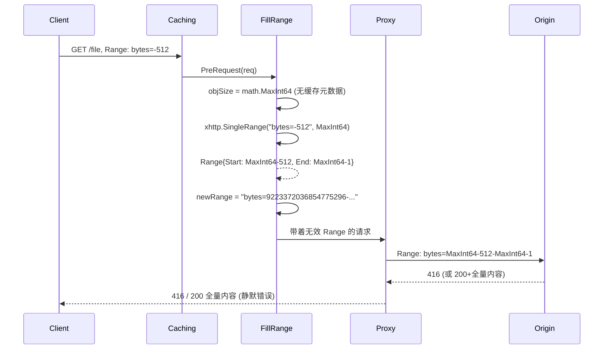

# Fix Issue #63: Unsupported Suffix Range

## Context

客户端发送 `Range: bytes=-512`（suffix range，请求文件最后 512 字节）时出现两个 bug：

1. multirange 中间件本地生成错误响应，而非透传到上游。当前代码构造 `BizError(416)`，issue 中观测为 500
2. fillRange 处理器在缓存未命中时将 suffix range 计算为 MaxInt64 级别的无效范围

根因是两个不同的 Range 解析器在处理 suffix range 时的行为不一致，且调用方未正确处理。

## Review 结论

方案方向正确，可以作为 issue #63 的修复基础。建议按以下优先级实施：

1. **P0: multirange 只处理可拆分的多 range**。`rangecontrol.Parse` 失败且请求是单 suffix range 时，不再本地返回错误，直接透传到下一层。
2. **P0: fillRange 在未知对象大小时跳过 suffix range 归一化**。不能用 `math.MaxInt64` 推导 suffix range 起始位置。
3. **P0: fillRange 的 suffix 检测要覆盖空白和混合 multi-range**。不要只判断 `strings.HasPrefix(rawRange, "bytes=-")`，避免任何 suffix range 在 cache MISS 时被改写成 MaxInt64 范围。
4. **P1: 修正 `xhttp.SingleRange` 的大 suffix 语义**。例如对象大小为 1000 时，`bytes=-9999` 应返回整个对象，而不是解析失败。
5. **P2: 明确混合 suffix multi-range 的策略**。例如 `bytes=0-99,-512` 不能简单透传到 caching HIT 路径，否则 `respondFromCache` 可能只返回第一个 range。

本次最低修复集合是 P0。P1/P2 不影响 issue 中的 `bytes=-512` 主路径，但如果目标是完整支持 suffix range，建议同 PR 或后续 PR 补齐。

## 中间件链执行顺序

```
recovery -> multirange -> caching -> proxy/upstream
```

## Bug 1: multirange 拒绝 suffix range 并生成错误响应

### 调用链

```mermaid
sequenceDiagram
    Client->>Recovery: GET /file, Range: bytes=-512
    Recovery->>MultiRange: RoundTrip(req)
    MultiRange->>MultiRange: rangecontrol.Parse("bytes=-512")
    MultiRange-->>MultiRange: ErrInvalidRange
    MultiRange-->>Recovery: BizError(416)
    Recovery-->>Client: error response (issue observed 500; current code intends 416)
```

### 根因

`server/middleware/multirange/multirange.go:46-52`:

```go
byteRanges, err := rangecontrol.Parse(rawRange)
if err != nil {
    headers := make(http.Header)
    headers.Set("X-Error", err.Error())
    return nil, xhttp.NewBizError(http.StatusRequestedRangeNotSatisfiable, headers)
}
```

`rangecontrol.Parse()`（`pkg/x/http/rangecontrol/request_range.go:71-73`）明确拒绝 suffix range:

```go
// suffix-range: "-500" (not supported without total size)
if strings.HasPrefix(part, "-") {
    return nil, ErrInvalidRange
}
```

multirange 对所有 Parse 错误都生成本地错误响应，但 suffix range (`bytes=-512`) 是 RFC 7233 合法的 HTTP Range 格式。multirange 的职责只是拆分多 range 请求做 MIME multipart 拼接，不应拦截 suffix range。

### 修复

Parse 失败时不要无脑返回错误。为降低行为变化，P0 推荐只对单 suffix range 透传到下一层，其他 malformed range 维持现有错误路径：

```go
byteRanges, err := rangecontrol.Parse(rawRange)
if err != nil {
    if isSingleSuffixRange(rawRange) {
        return origin.RoundTrip(req)
    }

    headers := make(http.Header)
    headers.Set("X-Error", err.Error())
    return nil, xhttp.NewBizError(http.StatusRequestedRangeNotSatisfiable, headers)
}
```

单 suffix range 例如 `bytes=-512` 透传后，cache MISS 会继续到 fillRange/proxy，cache HIT 会由 caching 使用已知对象大小正确计算。格式错误、倒序 range 等非本 issue 范围，保留现有行为，避免扩大变更面。

混合 suffix multi-range（例如 `bytes=0-99,-512`）是合法但更复杂：multirange 在没有对象大小时不能拆分，caching HIT 路径又不能正确返回 multipart。该 case 放入 P2，不能在 P0 中简单透传。

建议新增 helper：

```go
func isSingleSuffixRange(rawRange string) bool {
    const prefix = "bytes="
    if !strings.HasPrefix(rawRange, prefix) {
        return false
    }

    parts := strings.Split(strings.TrimPrefix(rawRange, prefix), ",")
    if len(parts) != 1 {
        return false
    }
    return strings.HasPrefix(strings.TrimSpace(parts[0]), "-")
}
```

## Bug 2: fillRange 将 suffix range 变成 max-int64 范围

### 调用链 (首次请求 cache miss)



### 根因

`server/middleware/caching/caching_fillrange.go:115-125`:

```go
func (f *fillRange) fill(c *Caching, req *http.Request, rawRange string) *http.Request {
    objSize := uint64(math.MaxInt64) // default value, set to MaxInt64
    if c.md != nil {
        objSize = c.md.Size
    }

    rng, err := xhttp.SingleRange(rawRange, objSize)
    if err != nil {
        return req  // 解析失败，原样透传
    }
    // ... 后续使用 rng.Start, rng.End
```

这里使用了两套不同的 Range 解析器：

| 解析器 | 文件 | suffix range 处理 |
|--------|------|-------------------|
| `rangecontrol.Parse()` | `request_range.go` | 明确拒绝 |
| `xhttp.SingleRange()` | `range.go` | 支持，但需要总大小 |

`xhttp.SingleRange()` 内部是 `unsatisfiableParser.Parse()`，它支持 suffix range 但必须知道文件总大小。当 `objSize = math.MaxInt64` 时：

- `start = MaxInt64 - 512`
- `end = MaxInt64 - 1`

返回值"合法"（无 error），但实际上是天文数字。然后被用于：
- `fill.newStart = int((uint64(rng.Start) / f.chunkSize) * f.chunkSize)` — 对齐到 chunk 边界
- `fill.rawStart = int(rng.Start)` — 约 9.2e18
- 最终构建 `Range: bytes=9223372036854775296-9223372036854775806`

发送到上游后，上游返回 416（或 200 全量——静默错误）。

后续 `PostRequest` (line 83) 中：
```go
if cr.ObjSize < uint64(fill.rawStart) {
    return nil, xhttp.NewBizError(http.StatusRequestedRangeNotSatisfiable, headers)
}
```
因为 `cr.ObjSize`（真实文件大小）远小于 MaxInt64 级别的 `fill.rawStart`，必然返回 416。

### 修复

在调用 `SingleRange` 前或成功后增加 suffix range + 未知 objSize 检测。推荐在调用前判断，避免先用 `math.MaxInt64` 计算出错误范围：

```go
if objSize == uint64(math.MaxInt64) && hasSuffixRange(rawRange) {
    return req
}

rng, err := xhttp.SingleRange(rawRange, objSize)
if err != nil {
    // unable to parse range, return original request
    return req
}
```

当 `c.md != nil`（缓存命中）时，`objSize` 为真实文件大小，`SingleRange` 能正确计算，此检查不生效。

### fillRange suffix range 检测

不要只使用 `strings.HasPrefix(rawRange, "bytes=-")`，它无法覆盖空白和混合 multi-range。fillRange 的目标不是完整响应这些 range，而是在未知对象大小时避免错误改写。建议新增一个小 helper：

```go
func hasSuffixRange(rawRange string) bool {
    const prefix = "bytes="
    if !strings.HasPrefix(rawRange, prefix) {
        return false
    }

    for _, part := range strings.Split(strings.TrimPrefix(rawRange, prefix), ",") {
        if strings.HasPrefix(strings.TrimSpace(part), "-") {
            return true
        }
    }
    return false
}
```

需要覆盖：

- `bytes=-512`
- `bytes= -512`
- `bytes=0-99,-512`
- `bytes=0-99, -512`

这样能保证未知对象大小时所有 suffix range 都不会进入 fillRange 的 chunk 对齐逻辑。

## P2: 混合 suffix multi-range 策略

`bytes=0-99,-512` 这类请求同时包含普通 range 和 suffix range。它的正确响应应是 multipart/byteranges，但当前修复不能简单把它从 multirange 透传到 caching：

- cache MISS: fillRange 可以跳过改写并交给 upstream，通常能得到正确响应。
- cache HIT: `caching.respondFromCache` 使用 `xhttp.SingleRange`，可能只处理第一个 range，返回错误的单 range 206。

因此 P2 有两个可选方向：

1. **在 multirange 支持带 suffix 的 multi-range**：先获取对象大小，再用支持 size 的 parser 计算所有 range，最后继续走 multipart 拼接。
2. **对混合 suffix multi-range 强制绕过 cache HIT**：让请求直接到 upstream，避免本地返回错误 body。

P0 不处理该 case，但测试应确保不会引入“cache HIT 只返回第一个 range”的静默错误。

## P1: SingleRange 的大 suffix 语义

当前 `pkg/x/http/range.go` 在解析 suffix range 时使用：

```go
start = size64 - end
end = size64 - 1
...
if start > end || start < 0 {
    continue
}
```

当请求 `bytes=-9999` 且对象大小只有 1000 时，`start` 为负数，解析失败。但 RFC 语义下 suffix 长度大于对象大小时应返回整个对象，即 `bytes 0-999/1000`。

建议修正为：

```go
if startErr != nil {
    if end > size64 {
        start = 0
    } else {
        start = size64 - end
    }
    end = size64 - 1
}
```

这项不是解决 `bytes=-512` + MaxInt64 的必要条件，但属于 suffix range 支持的完整性补强。

## 边界情况

| 场景 | 修复前 | 修复后 |
|------|--------|--------|
| `bytes=-512` cache MISS | 416 / MaxInt64 无效范围 | 透传到上游，返回最后 512 字节 |
| `bytes=-512` cache HIT | 416 | 透传到 caching，使用已知 Size 正确返回 |
| `bytes= -512` cache MISS | 可能进入 MaxInt64 计算或解析异常 | 识别为 suffix range 并透传 |
| `bytes=0-99,-512` cache MISS | 可能被 multirange 或 fillRange 错误处理 | P2 处理；P0 不承诺完整支持 |
| `bytes=0-99,-512` cache HIT | multirange 可能返回错误；若简单透传可能只返回第一个 range | P2 需避免静默错误 |
| `bytes=-9999` 且对象大小 1000 | `SingleRange` 解析失败 | P1 修复后返回整个对象 |
| `bytes=0-499` 单 range | 透传（不受影响） | 不变 |
| `bytes=0-99,200-299` 多 range | multipart 响应 | 不变 |
| `bytes=100-` 开区间单 range | 透传（len <= 1） | 不变 |
| 无 Range 头 | 透传 | 不变 |
| `bytes=abc` 格式错误 | 416 | P0 保持现有错误行为 |

## 修改文件

### 1. `server/middleware/multirange/multirange.go` line 46-52

Parse 失败且 `isSingleSuffixRange(rawRange)` 为 true 时 `return origin.RoundTrip(req)`；其他 parse error 保持现有 `NewBizError(416)` 路径。新增 `isSingleSuffixRange(rawRange string) bool` helper。

### 2. `server/middleware/caching/caching_fillrange.go` line 121-125 之后

在 `SingleRange` 前增加 suffix range + 未知 objSize 检测，提前 return。新增 `hasSuffixRange(rawRange string) bool` helper，覆盖空白和混合 multi-range。

### 3. `pkg/x/http/range.go`（P1，可选但推荐）

修正 suffix length 大于对象大小时的解析语义：`bytes=-N` 且 `N >= size` 时返回 `0-size-1`。

## 不修改的文件

- `pkg/x/http/rangecontrol/request_range.go` — `Parse()` 有意不支持 suffix range（无总大小），设计正确
- `server/middleware/caching/caching.go` — `respondFromCache` (line 208) 使用 `c.md.Size`（始终已知），工作正常
- `server/server.go` — 中间件链和错误处理无需修改

## 测试

### 单元测试

**新建 `server/middleware/multirange/multirange_test.go`**:
- suffix range 透传验证
- 带空白的 suffix range 透传验证：`bytes= -512`
- 混合 suffix 的 multi-range 不应在 P0 中简单透传到 caching HIT 路径：`bytes=0-99,-512`
- 单 range 透传验证
- 多 range 拦截验证（防止回归）
- 无 Range 透传验证
- malformed range 保持现有错误行为：`bytes=abc`

**新建 `server/middleware/caching/caching_fillrange_test.go`**:
- 未知 objSize 时 suffix range 透传
- 未知 objSize 时带空白 suffix range 透传
- 未知 objSize 时混合 suffix multi-range 不被 fillRange 改写
- 已知 objSize 时 suffix range 正常填充
- 常规 range 填充不受影响（防止回归）

**补充 `pkg/x/http/range_test.go` 或新增同包测试（P1）**:
- `bytes=-512`, size=1000 -> `Start=488`, `End=999`
- `bytes=-9999`, size=1000 -> `Start=0`, `End=999`
- `bytes=-0`, size=1000 -> 解析失败或按当前约定保持不可满足，需在测试名中明确语义

### 集成回归

建议补一个端到端测试，验证同一资源两次 suffix range 请求：

1. 首次 MISS: `Range: bytes=-512` 透传到 origin，返回 206，body 为源文件最后 512 字节
2. 二次 HIT: 使用缓存元数据 `Size` 正确计算 suffix range，返回同样的 206 和 body
3. 验证 `Content-Range` 为 `bytes <size-512>-<size-1>/<size>`

### 回归测试

```bash
go test -count=1 -v ./server/middleware/...
go test -count=1 -v ./pkg/x/http/...
go vet ./server/middleware/...
```

## 实施步骤

1. 修改 `multirange.go`：`rangecontrol.Parse` 报错时，仅对单 suffix range 直接 `return origin.RoundTrip(req)`，其他 parse error 保持现有错误行为。
2. 修改 `caching_fillrange.go`：新增 `hasSuffixRange`，在 `objSize == math.MaxInt64` 且命中 suffix range 时跳过 fillRange 改写。
3. 按 P1 决策修改或暂缓 `pkg/x/http/range.go` 的大 suffix 语义。
4. 新增单元测试，先覆盖 P0 主路径，再覆盖 P1 边界。
5. 跑 middleware 和 range parser 相关测试。
